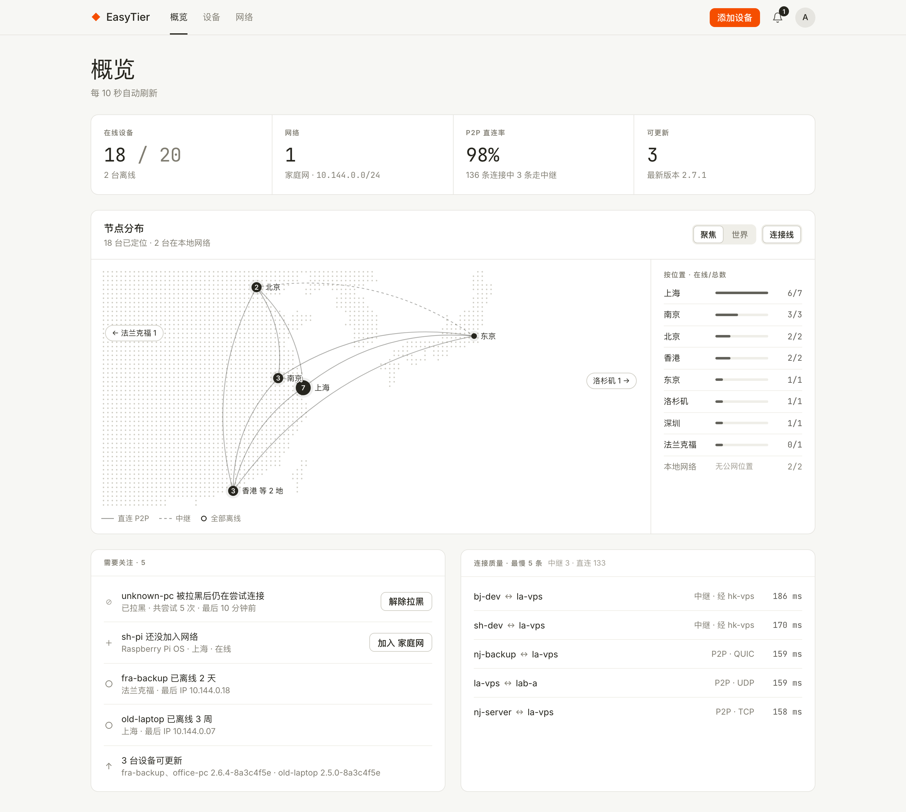
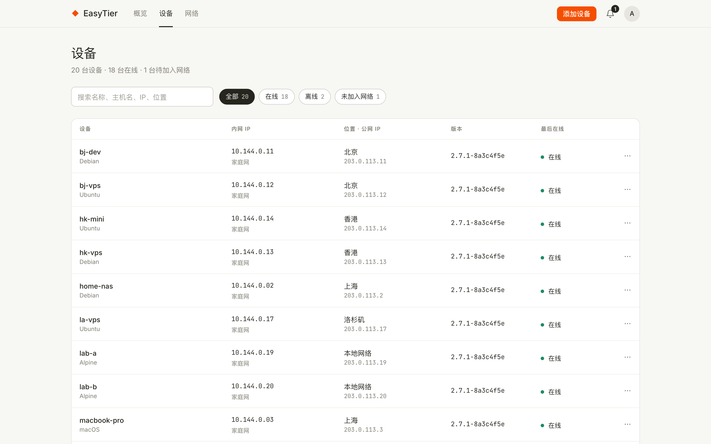
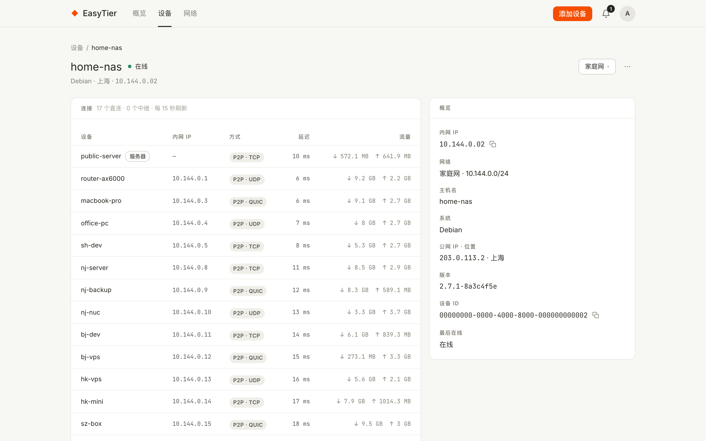
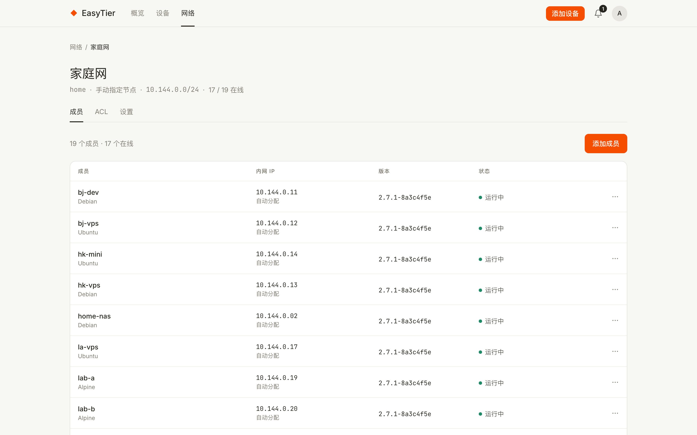
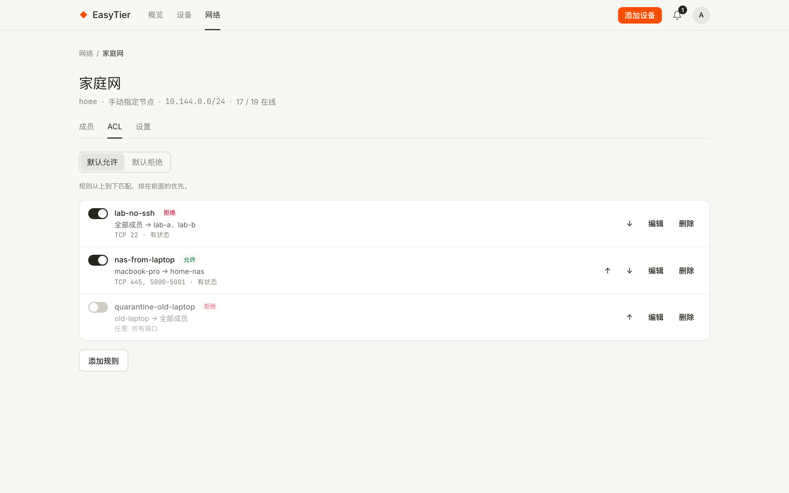
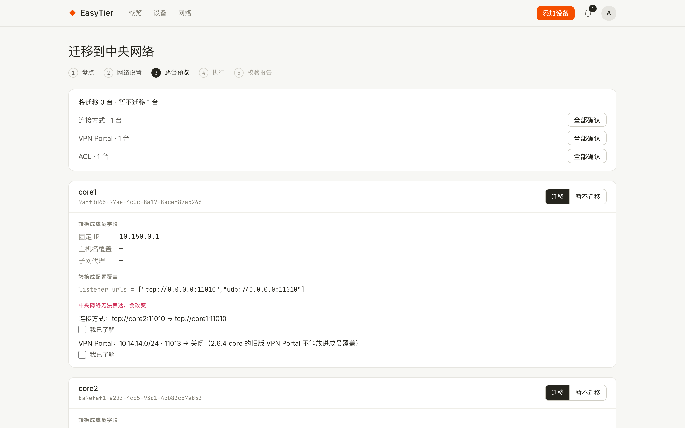

# EasyTier Web Console

[EasyTier](https://github.com/EasyTier/EasyTier) 的新 Web 控制台。直接对接原版 `easytier-web` v2.7.1 的 API，用原来的账号登录，数据库不用改；纯静态文件，部署时把 `/api/` 反代到 easytier-web 即可。



<sub>截图均为 mock 数据。</sub>

## 功能

- **概览**：在线设备、P2P 直连率、可更新设备，节点地图，需要关注的设备和最慢的连接
- **设备**：搜索与筛选，每台设备的连接、延迟、流量和在网络中的设置
- **网络**：成员管理、ACL、安全模式凭据、网络设置
- **配置编辑器**：表单 / TOML 双模式，成员覆盖、手动实例、VPN Portal
- **迁移向导**：把 2.6.4 时代的旧网络实例逐台迁到中央网络，可校验、可回滚

| 设备 | 设备详情 |
| --- | --- |
|  |  |
| **网络成员** | **ACL** |
|  |  |



## 快速开始

```sh
npm install
ET_API=http://<easytier-web>:11211 npm run dev   # 开发
npm run build                                    # 产物在 dist/
```

## 文档

- [使用与部署指南](docs/guide.md)：开发、测试、部署、各页面说明
- [部署示例](deploy/README.md)：easytier-web + Caddy
- [升级手册](docs/upgrade-runbook.md)：easytier-web 2.6.4 → 2.7.1

## 许可证

LGPL-3.0-or-later，见 [LICENSE](LICENSE)。部分文件移植自 EasyTier v2.7.1，文件开头有标注。
